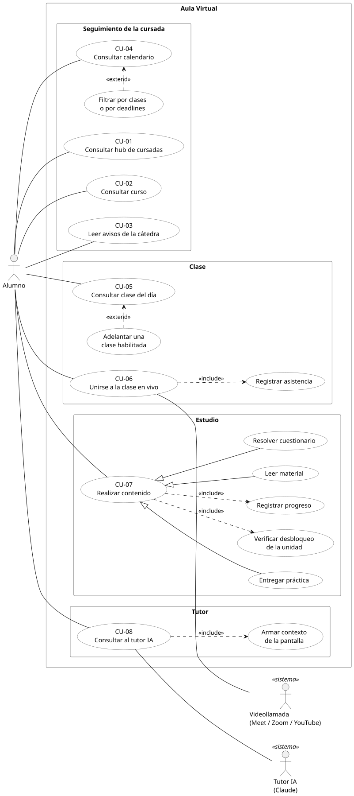

# Casos de uso: Alumno

Fuente editable: [alumno.puml](alumno.puml). Para regenerar: `java -jar plantuml.jar -tsvg docs/casos-de-uso/alumno.puml`.

Precondición común: el alumno inició sesión y pertenece al grupo `alumno`.

| CU | Nombre | Pantalla | Qué resuelve | Modelos que usa | Patrón |
|---|---|---|---|---|---|
| CU-01 | Consultar hub de cursadas | Inicio | Cursadas activas, próximas fechas y últimos avisos en una sola vista | `Catedra`, `Evento`\*, `Aviso`\*, `Progreso` | — |
| CU-02 | Consultar curso | Curso | Ficha de la cátedra (profesorado, horarios, programa), próxima clase y el recorrido de unidades con su estado | `Catedra`, `Horario`\*, `Unidad`, `Contenido`, `Progreso` | — |
| CU-03 | Leer avisos de la cátedra | Avisos del curso | Comunicación de la cátedra hacia los alumnos. Solo la cátedra publica | `Aviso`\* | Observer (al publicar se notifica) |
| CU-04 | Consultar calendario | Calendario | Mes con clases recurrentes y deadlines, filtrable por tipo | `Horario`\*, `Clase`\*, `Evento`\* | — |
| CU-05 | Consultar clase del día | Clase de hoy | La sesión de hoy (o una próxima habilitada) con temario, material y tareas | `Clase`\*, `Contenido` | — |
| CU-06 | Unirse a la clase en vivo | Clase de hoy | Link de videollamada y registro de asistencia | `Clase`\*, `Asistencia`\* | — |
| CU-07 | Realizar contenido | Contenido | Leer material, resolver un cuestionario o entregar una práctica | `Contenido`, `Progreso` | Strategy (un template y un criterio de completado por formato), Observer (desbloqueo) |
| CU-08 | Consultar al tutor IA | Botón flotante en todas las pantallas | Pregunta con el contexto de la pantalla actual; la IA indica dónde está el tema en el material | `ConsultaTutor`\* (opcional) | Facade + Adapter |

\* Modelo que todavía no existe en `aula/models.py`.

## Flujo principal de CU-07 (Realizar contenido)

1. El alumno abre un contenido publicado desde el curso o desde la clase del día.
2. El sistema verifica que la unidad del contenido esté desbloqueada (`Unidad.esta_desbloqueada`).
3. El sistema muestra el contenido con el template de su formato.
4. El alumno lo realiza: marca la lectura, envía el cuestionario o sube la práctica.
5. El sistema evalúa el criterio de completado del formato y registra el `Progreso` (intentos, respuesta, archivo, `completado_en`).
6. Si con eso la unidad queda completa, se desbloquea la siguiente.

Alternativos:
- **2a. Unidad bloqueada:** el sistema informa qué unidad falta completar o la fecha de apertura.
- **5a. Cuestionario no aprobado:** se registra el intento sin `completado_en` y el alumno puede reintentar.
- **5b. Entrega fuera de término:** se registra igual y queda marcada como fuera de término (`Progreso.en_termino()`).

## Flujo principal de CU-08 (Consultar al tutor IA)

1. El alumno abre el tutor desde cualquier pantalla y escribe una pregunta.
2. El sistema arma el contexto de la pantalla: qué pantalla es, la cátedra, la unidad o la clase, y las fechas próximas.
3. El sistema le pasa a la IA la pregunta, el contexto y el material **publicado** de las cátedras del alumno.
4. La IA explica el tema en términos generales e indica la unidad y el contenido donde se estudia. No resuelve actividades evaluables.
5. El sistema muestra la respuesta con un hipervínculo a cada contenido citado.

Alternativos:
- **3a. La IA no está disponible:** el Adapter traduce el error y el tutor muestra un mensaje sin romper la pantalla.
- **4a. El tema está en una unidad bloqueada:** la IA lo menciona, pero aclara que primero hay que completar la unidad anterior.

## Impacto en el esquema

La vista de producto agrega conceptos que el esquema actual (`docs/schemas/schema.mmd`) no tiene:

| Concepto | Propuesta | Motivo |
|---|---|---|
| Horario de cursada | `Horario(catedra, dia_semana, hora_inicio, hora_fin, aula)` | Bloques recurrentes en el calendario y la ficha del curso |
| Clase | `Clase(catedra, numero, fecha, hora_inicio, titulo, resumen, unidad, link_videollamada, contenidos M2M)` | La pantalla "Clase de hoy" agrupa por fecha y no por unidad |
| Asistencia | `Asistencia(alumno, clase, registrada_en)` | Registro de asistencia desde el link en vivo |
| Fecha importante | `Evento(catedra, tipo, titulo, fecha, contenido?)`, con tipo entrega, parcial, presentación o final | Los parciales no son contenidos de la plataforma, pero tienen que aparecer en el hub y en el calendario |
| Aviso | `Aviso(catedra, autor, titulo, cuerpo, publicado_en)` | Foro de avisos de solo lectura para el alumno |
| Material oficial | `archivo` en `Contenido` o un modelo `Material` | Hoy `cuerpo` es JSON y no puede guardar PDFs |
| Teoría y práctica | Derivado del formato: el texto es teoría; el cuestionario y la práctica son práctica | Las barras de progreso por unidad salen del `Progreso` existente, sin campos nuevos |

## Decisiones tomadas

1. **Sin calificaciones.** Parciales, entregas, presentaciones y finales son `Evento` del calendario. La plataforma no califica. La carga de eventos se define en la perspectiva del profesorado.
2. **Alcance del tutor.** Explica el tema en términos generales y enlaza el material de estudio donde se trata. No resuelve cuestionarios ni prácticas.
3. **Fe de erratas.** Si el profesorado corrige o agrega contenido en una unidad que el alumno ya completó, ese contenido no vuelve a bloquear el recorrido. Va a una unidad especial *Fe de erratas*, fuera de la secuencia de desbloqueo, que referencia las unidades que corrige. Queda pendiente definir su modelado en el diagrama de clases.
4. **Sin flashcards.** Se quitan como formato de contenido: aportan poco frente a texto y cuestionario. Quedan tres formatos: texto, cuestionario y práctica.
